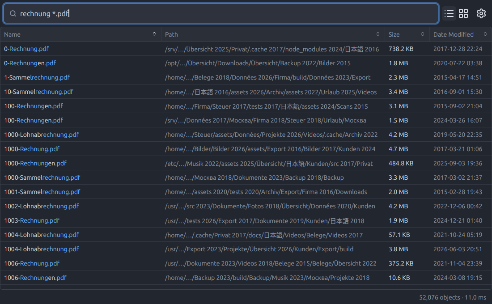
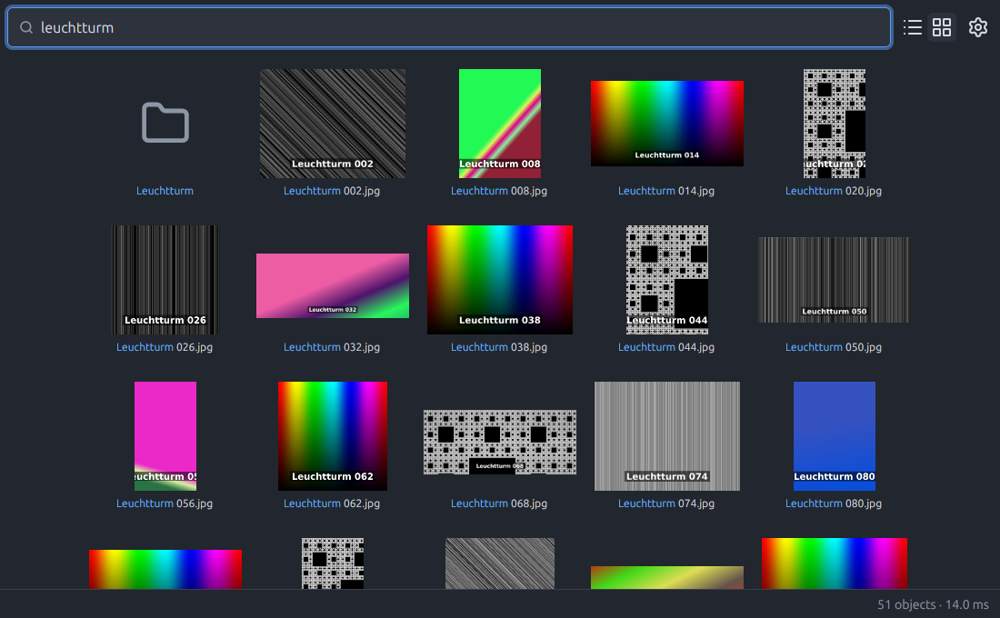
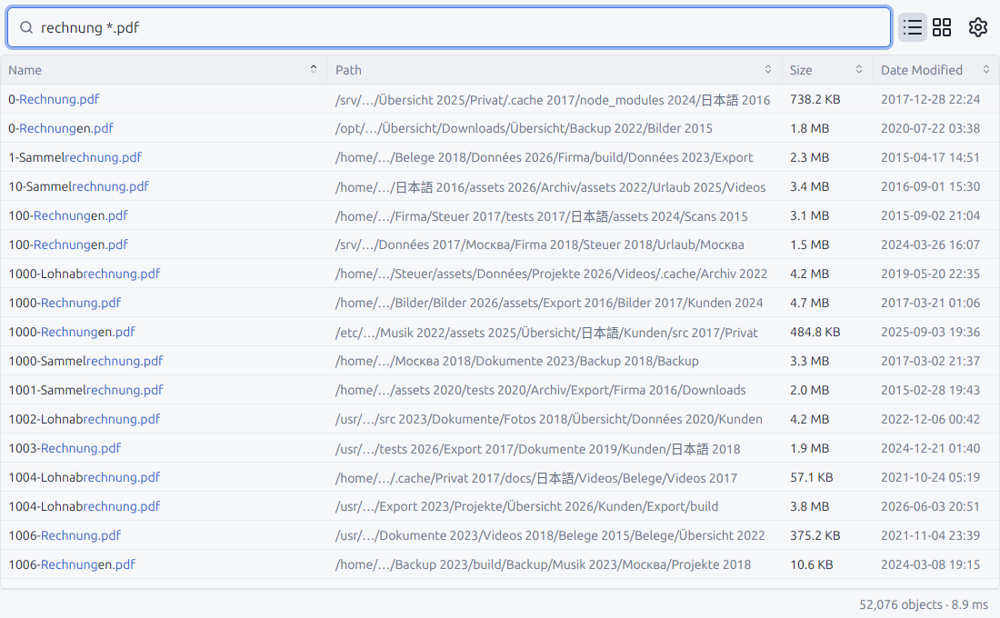

<div align="center">


# Anything

**Instant file name search for Linux, in the spirit of [Everything](https://www.voidtools.com/) by voidtools.**

**Index 5 million files in 3 seconds. Find any of them before you finish typing.**

### Install on Debian, Ubuntu or Linux Mint

```sh
wget https://github.com/srcmkr/anything/releases/latest/download/anything_amd64.deb
sudo apt install ./anything_amd64.deb
```

Other distributions: download the
**[AppImage](https://github.com/srcmkr/anything/releases/latest/download/Anything-x86_64.AppImage)**,
make it executable and start it.

[](https://github.com/srcmkr/anything/releases/latest)
[](https://github.com/srcmkr/anything/actions/workflows/build.yml)
[](#license)



</div>

## What it does

- **Results while you type**, across millions of files: each keystroke
  searches the whole index and shows the result within about 20 ms.
- **One click away** in the tray; <kbd>Esc</kbd> hides it again.
- **Always current**: new, renamed and deleted files show up within seconds.
- **Every disk, only your files**: an optional system service indexes all
  local disks once for everybody, and each user sees only what they could
  open themselves.
- **A grid with previews** of pictures, videos and PDFs.
- **Act on what you find**: open, open with, show in folder, copy, move to the
  trash with undo, properties.

<table>
  <tr>
    <td></td>
    <td></td>
  </tr>
</table>

## Install

Every [release](https://github.com/srcmkr/anything/releases/latest) has three files:

| For | File | Then |
|---|---|---|
| Debian, Ubuntu, Linux Mint | `anything_<version>_amd64.deb` | `sudo apt install ./anything_*_amd64.deb` |
| Any other distribution | `Anything-<version>-x86_64.AppImage` | `chmod +x Anything-*.AppImage && ./Anything-*.AppImage` |
| By hand | `anything-<version>-x86_64-linux.tar.gz` | Unpack, start `./anything`, then *Settings → About → Install for all users* |

The Debian package sets up the search service right away. With the AppImage
or the archive, turn it on under *Settings → Service*; without it, Anything
indexes your own files by itself. New versions are offered in the app and
installed on request.

You need a tray that supports StatusNotifierItem (KDE, Cinnamon, XFCE, GNOME
with the AppIndicator extension). Anything is developed on X11; Wayland is not
well tested yet.

## Searching

Terms are separated by spaces and must all match; case does not matter.

| You type | Finds |
|---|---|
| `rechnung` | names containing it anywhere: `Rechnung-123.pdf`, `Sammelrechnung.pdf` |
| `*.pdf` | names ending in `.pdf`: a term with `*` must match the whole name |
| `rechnung*.pdf` | `Rechnung-123.pdf`, but not `123-Rechnung.pdf` |
| `rechnung *.pdf` | names matching both terms |

<kbd>↓</kbd> moves into the results, <kbd>Enter</kbd> opens,
<kbd>Ctrl</kbd>+<kbd>Enter</kbd> shows the folder, <kbd>Del</kbd> moves to the
trash, <kbd>Ctrl</kbd>+<kbd>2</kbd> switches to the grid,
<kbd>Ctrl</kbd>+<kbd>,</kbd> opens the settings. Right-click a result for
everything else. There is also a command line client: `any rechnung '*.pdf'`.

## Speed, privacy and safety

On a desktop with 5.5 million files, a full scan takes about three seconds
and a search about ten milliseconds; the window keeps up with a 120 Hz display
while scrolling. Numbers and how to measure them yourself:
[docs/performance.md](docs/performance.md).

Anything never sends your file names anywhere. Previews are made in a
sandbox, deleting asks or can be undone, and updates are signed and checked
before they are installed: [docs/security.md](docs/security.md).

Anything speaks English, German, Spanish, French, Portuguese (Brazil), Russian
and Chinese (simplified).

## Contributing

Bug reports, ideas, translations and pull requests are welcome. See
[CONTRIBUTING.md](CONTRIBUTING.md) for building from source, the layout of
the code and how releases are made. *Settings → About → Copy info* puts
version and system details on the clipboard for a bug report, without any
file names.

## Credits

Anything exists because of **[Everything](https://www.voidtools.com/)** by
**voidtools** (David Carpenter). It is an independent project, not affiliated
with or endorsed by voidtools. Built with [GPUI](https://www.gpui.rs/), the UI
framework of the [Zed](https://zed.dev/) editor, and
[gpui-component](https://github.com/longbridge/gpui-component).

## License

Licensed under either of [Apache License, Version 2.0](LICENSE-APACHE) or
[MIT license](LICENSE-MIT) at your option. Unless you explicitly state
otherwise, any contribution intentionally submitted for inclusion in the work
by you, as defined in the Apache-2.0 license, shall be dual licensed as above,
without any additional terms or conditions.
